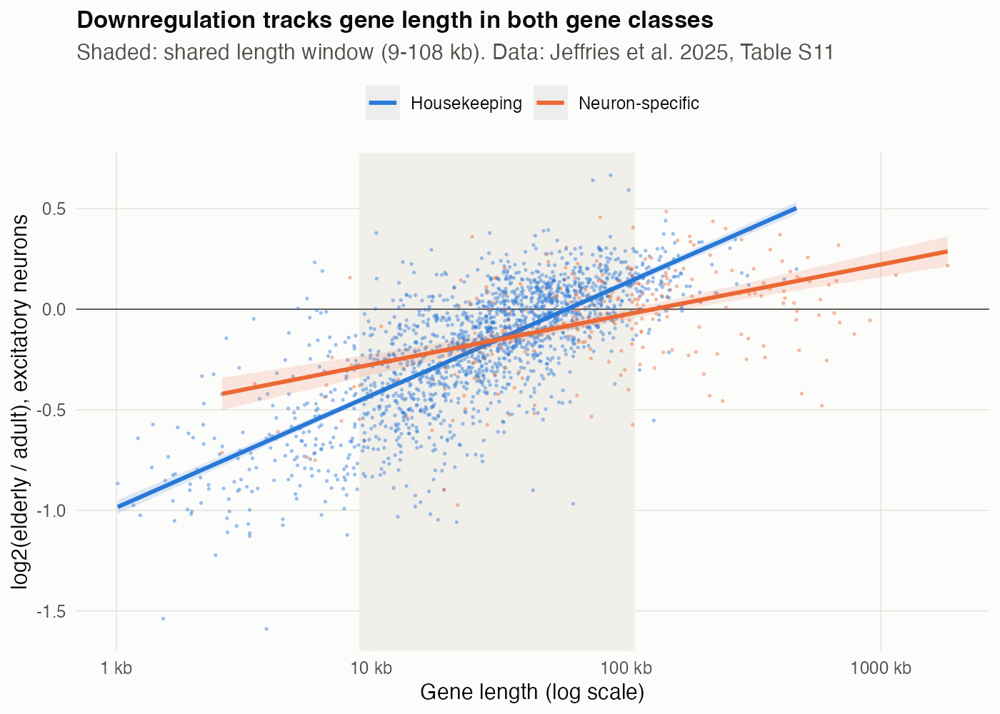
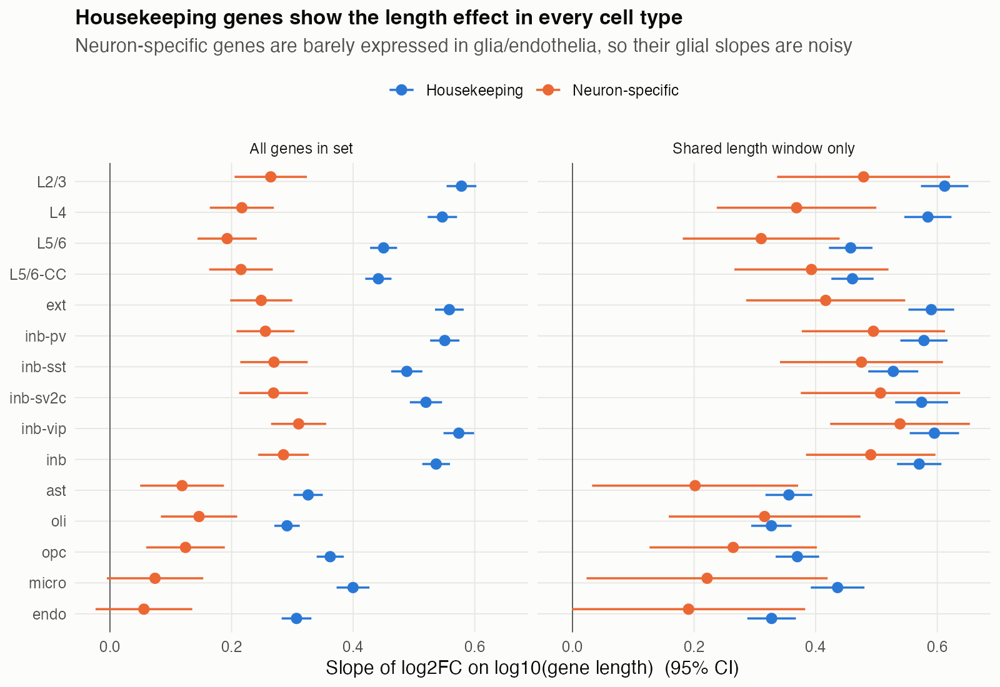
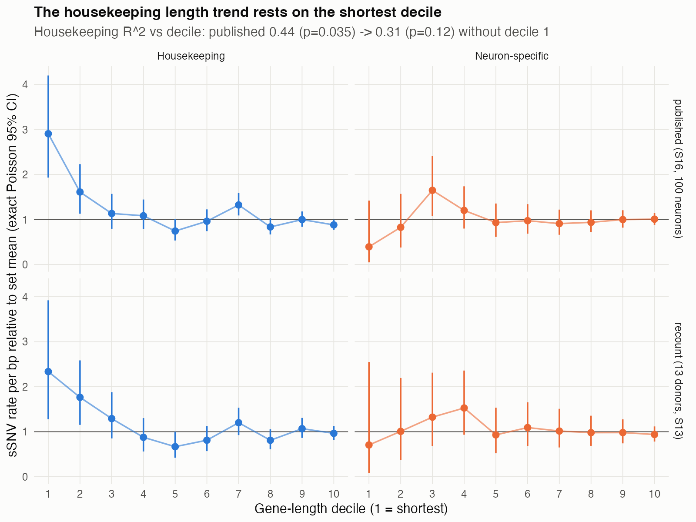
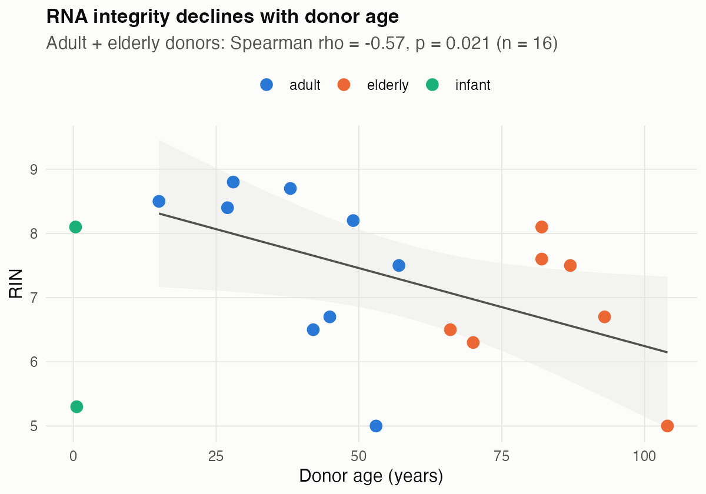

# Re-analysis of Jeffries et al. 2025 (*Nature*): gene length, ageing and somatic mutation in human neurons

An independent re-test of the central claim of
[Jeffries et al., *Nature* 646:657 (2025)](https://doi.org/10.1038/s41586-025-09435-8):
that **short, highly expressed housekeeping genes accumulate somatic SNVs and lose expression
with age in human prefrontal-cortex neurons, while long neuron-specific genes are preserved.**

The study's raw data are controlled-access (dbGaP phs003445.v1.p1), so this re-analysis uses only
public material: the paper's supplementary tables, Ensembl/UCSC gene annotation, and two external
housekeeping-gene lists. Everything is in R and runs end-to-end in a couple of minutes.

## Summary

| Claim in the paper | Re-analysis | Assessment |
|---|---|---|
| Expression change in ageing rises with gene length in housekeeping genes (Fig. 5f; R² = 0.50) | Gene level: R² = 0.51 with length decile as predictor, 0.55 with continuous length; p < 10⁻²⁷⁰ | Reproduces |
| The housekeeping result is not an artefact of defining the gene set on the same data | Similar slope in genes also on an external housekeeping list (0.56) and in genes not on it (0.53) | Holds with an external gene list |
| Neuron-specific genes show a much weaker length relationship (Fig. 5g; R² = 0.20, P = 1.2 × 10⁻³) | Gene level: R² = 0.24, p = 6 × 10⁻¹⁹. In the length window both classes share, the neuron-specific slope is ~70% of the housekeeping slope | Length relationship is also present in neuron-specific genes; length and expression level cannot be separated with the public tables |
| sSNV rate per bp falls with gene length in housekeeping genes (Fig. 5i; R² = 0.44, P = 0.035) | Reproduces on deciles (R² = 0.44); p = 0.12–0.20 without the shortest decile. Housekeeping and neuron-specific slopes do not differ (p = 0.30–0.44). Unchanged after removing possible artefactual recurrent calls | Reproduces; depends on the shortest decile |
| Elderly and adult donors are comparable | RIN falls with age (ρ = −0.57, p = 0.021); depth, genes per nucleus, PMI and storage time are balanced | RIN differs by age and is not adjusted for in the published fold changes |

## Findings

### 1. The expression–length relationship reproduces, and it tracks gene length more than gene class
Using the per-gene fold changes in Table S11, the housekeeping result reproduces closely
(excitatory neurons: R² = 0.51 with length decile as predictor vs 0.50 published).

The two gene classes barely overlap in length: neuron-specific genes are mostly long, and
housekeeping genes mostly short. Pooling both classes in excitatory neurons:

| Model for log2(elderly/adult) | R² |
|---|---|
| gene length only | **0.49** |
| gene class (housekeeping vs neuron-specific) only | 0.02 |
| length + class | 0.50 |
| length × class | 0.53 |

Within the 9–108 kb window that both classes share, neuron-specific genes still have a clearly
positive slope (0.42 vs 0.59 for housekeeping; difference p = 0.008). The pattern is present in
every cell type, including glia and endothelium, though weaker there (Fig. 2). Removing ribosomal
and OXPHOS genes does not change the slope (0.55 vs 0.56).

**Interpretation:** short genes tend to decrease and long genes to increase with age, in most cell
types and in both gene classes. This is consistent with the paper's proposed mechanism, and it is
also consistent with a global length-dependent effect, such as RNA integrity or the intronic-read
fraction under intron-inclusive counting. The public tables cannot separate these explanations
(see Next steps).

**Caveat: length also stands in for expression level.** Short housekeeping genes are also among
the most highly expressed, and the public tables do not include per-gene expression values that
could enter the model. "Length explains 49%" therefore means length, or the expression level that
goes with it. The paper's multiple regression (Table S15) includes basal expression alongside
length; it cannot be refitted at the gene level from the public tables.




### 2. The mutation–length trend depends on the shortest decile
The deposited per-SNV table (S13 "Detailed information") holds **19,585 of the 34,089** sSNVs
called across 100 neurons. Six of 19 donors are missing and four are partial, so Table S16
cannot be rebuilt exactly. Because the available calls come from 13 donors rather than a random
sample of all calls, the recount tests whether the published pattern holds, not whether its
exact values reproduce. Recounting the available calls by coordinate overlap with GRCh37 gene
bodies gives decile counts about 0.6× the published ones, with the same shape.

| Housekeeping: rate vs length decile | R² | p |
|---|---|---|
| Published (S16, 100 neurons) | 0.44 | 0.035 |
| Published, decile 1 removed | 0.31 | 0.12 |
| Recount (13 donors) | 0.44 | 0.038 |
| Recount, decile 1 removed | 0.23 | 0.20 |

Gene-level negative-binomial models (`n_snv ~ log10(length) + offset(log length)`):

| Gene set | Rate change per 10× length | p |
|---|---|---|
| Housekeeping | 0.50× | 0.026 |
| Housekeeping, decile 1 removed | 0.64× | 0.19 |
| Housekeeping, 20–200 kb only | 1.26× | 0.64 |
| Neuron-specific | 0.73× | 0.28 |
| Housekeeping vs neuron-specific slope difference | — | **0.44** |
| All other protein-coding genes | 1.40× | 1 × 10⁻⁹ |

The elevated rate in the shortest ~180 housekeeping genes is robust: in the published counts,
decile 1 has a 2.9× excess (exact Poisson 95% CI 1.9–4.2). It does not extend into a trend
across lengths, and it does not separate housekeeping from neuron-specific genes. In all other
protein-coding genes the per-bp rate rises with length, so a falling rate with length is not a
genome-wide property of these calls. Because rates here are per annotated bp rather than per
callable bp, these comparisons are approximate. Callable-region size and GC content affect
PTA/SCAN2 sensitivity, are not in the public data, and could matter most for short, GC-rich genes.

**Sensitivity to possible artefactual calls.** Nine sites are called somatic in two or more
unrelated donors, which is unlikely for true somatic mutations, so they are probably technical
artefacts. Another 468 rows repeat a site within one donor (clonal mutations shared by several
neurons). Removing either does not change the conclusions
(`results/tables/mutation_sensitivity_recurrent_calls.tsv`):

| SNV calls used | Housekeeping p | Housekeeping p, decile 1 removed | Housekeeping vs neuron-specific slope p |
|---|---|---|---|
| All 19,585 | 0.026 | 0.19 | 0.44 |
| Cross-donor recurrent sites removed | 0.018 | 0.14 | 0.36 |
| + clonal duplicates collapsed | 0.019 | 0.13 | 0.30 |



### 3. RNA integrity declines with age in this cohort
Across the 16 adult and elderly donors with RIN, RIN correlates with age (Spearman ρ = −0.57,
p = 0.021; median 8.2 adult vs 6.7 elderly). Sequencing depth, genes per nucleus, PMI and storage
time do not differ, and library batches mix ages. The published fold changes come from a
cell-level Wilcoxon test without covariates (Methods), so they are not adjusted for RIN.



## Limitations
- Per-gene fold changes are public only for the 1,802 housekeeping and 288 neuron-specific genes,
  so a genome-wide length test is not possible from these tables.
- Gene length and expression level are confounded (short housekeeping genes are highly
  expressed), and per-gene expression is not public, so the length effect cannot be separated from
  an expression-level effect.
- The fold changes are the paper's own (Seurat, cell-level Wilcoxon). Without donor-level counts
  they cannot be recomputed as pseudobulk or adjusted for RIN.
- The mutation analysis uses the 57% of sSNVs in the deposited table, from 13 of 19 donors.
  Callable regions per neuron are not available, so rates are per annotated bp. A few calls look
  like technical artefacts (recurrent across unrelated donors); results are unchanged without them.

## Next steps
Repeat the expression test in an independent cohort with donor-level counts and RIN/PMI, such as
Ling et al. 2024 (*Nature*; snRNA-seq of dorsolateral prefrontal cortex, BA46, from 191 donors
aged 22–97, 97 without a psychiatric diagnosis), subject to its data-access terms. That means
donor-level pseudobulk (edgeR/limma) with RIN as a covariate, followed by a genome-wide test of
fold change against gene length *and* baseline expression, which would separate the two.

## Reproduce
```bash
Rscript scripts/install_packages.R   # one-time: readxl, data.table, ggplot2, patchwork, MASS, org.Hs.eg.db, GenomicRanges
bash run_all.sh                      # downloads public data, then runs scripts 02-08
```
Tested with R 4.3.3. Source data are downloaded at run time and are not redistributed in this
repository.

| Script | Purpose |
|---|---|
| `00_download.sh` | Supplementary files from *Nature*; GRCh37 gene table (annotables); external housekeeping lists (scMerge) |
| `01_inspect_supp.R` | Inventory every sheet of the supplementary workbooks |
| `02_tidy_supp.R` | Workbooks → tidy TSVs |
| `03_gene_lengths.R` | Gene-body lengths (org.Hs.eg.db, hg38) and alias table |
| `04_reproduce_s16.R` | S13 completeness; gene-level sSNV counts on GRCh37; comparison with S16 |
| `05_mutation_vs_length.R` | Negative-binomial models and decile R² for sSNV rate vs length |
| `06_expression_vs_length.R` | Expression change vs length: reproduction, length-matched, by cell type, external housekeeping lists |
| `07_donor_covariates.R` | RIN, PMI, storage, library QC vs age group |
| `08_figures.R` | Figures |

Outputs are in `results/tables/` and `results/figures/`. Genes whose annotated length disagrees
with the paper's decile by more than 5× (UCSC/Ensembl vs GENCODE gene-model differences) are
excluded: 32 of 2,090 in the expression analysis and 6 in the mutation analysis.

## Data sources
- Jeffries, A.M. et al. Single-cell transcriptomic and genomic changes in the ageing human brain. *Nature* **646**, 657–666 (2025). Supplementary Tables 1–16.
- Ensembl GRCh37 gene coordinates via [`annotables`](https://github.com/stephenturner/annotables).
- Eisenberg, E. & Levanon, E.Y. Human housekeeping genes, revisited. *Trends Genet.* **29**, 569 (2013); Lin, Y. et al. scMerge leverages factor analysis, stable expression, and pseudoreplication to merge multiple single-cell RNA-seq datasets. *PNAS* **116**, 9775–9784 (2019). Lists via [`scMerge`](https://github.com/SydneyBioX/scMerge).
- `org.Hs.eg.db` (Bioconductor) for hg38 gene positions and symbol aliases.
- Ling, E. et al. A concerted neuron–astrocyte program declines in ageing and schizophrenia. *Nature* **627**, 604–611 (2024).

## Acknowledgement
Thanks to the original authors for depositing detailed supplementary data.

*This is an independent re-analysis for learning purposes and is not affiliated with the original authors.*
